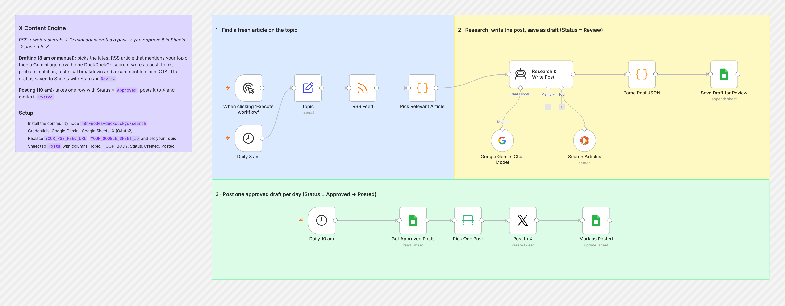

# n8n Workflows by Pranav Singla

**AI automations I've built in n8n for outbound sales, inbound lead response, voice agents and content.** Each one is exported from a real build, stripped of client data and keys, and documented so you can import it and run it yourself.

[](https://pranavtheaiguy.vercel.app)
[](https://www.linkedin.com/in/pranavsingla202/)
[](https://x.com/pranavtheaiguy)


---

## Workflows

| Workflow | What it does | Stack |
|---|---|---|
| [**AI SDR Outbound Engine**](./workflows/ai-sdr-outbound-engine) | LinkedIn-first, email-second outbound. Pulls ICP leads from Apollo, sends a Gemini-written LinkedIn note, follows up by email after 3 days if there's no reply, and tracks every status in HubSpot. | Apollo · HubSpot · Gemini · PhantomBuster · Smartlead · Slack |
| [**WhatsApp Inbound Lead Engine**](./workflows/whatsapp-inbound-lead-engine) | A website form lead gets a Claude-written WhatsApp reply within seconds. Includes a duplicate check and JSON guardrails. | Webhook · Claude · WhatsApp Cloud API · Sheets · Slack |
| [**AI Website Scraper & Icebreaker**](./workflows/ai-website-scraper-icebreaker) | Crawls each prospect's website, summarises every page, and writes cold-email openers based on real research. | Apollo · Firecrawl · Gemini · Sheets · Gmail |
| [**Voice Agent Assistant**](./workflows/voice-agent-assistant) | An n8n MCP server with 5 Google Calendar tools, so a Vapi voice agent can check, book, move and cancel events mid-call. | MCP · Vapi · Google Calendar |
| [**X Content Engine**](./workflows/x-content-engine) | Drafts researched X posts every morning. You approve them in Sheets and one is published each day. | RSS · Gemini agent · DuckDuckGo · Sheets · X API |
| [**LinkedIn Outreach Automation**](./workflows/linkedin-outreach-automation) | Sends daily personalised connection requests from HubSpot leads and syncs acceptances back to the CRM. | HubSpot · Gemini · PhantomBuster · Sheets · Slack |
| [**Reddit Lead Finder**](./workflows/reddit-lead-finder) | Finds Reddit posts with buying intent, scores them with Gemini in batches, and alerts you to hot leads along with a ready-to-send DM. | Reddit API / Apify · Gemini · Sheets · Telegram |

## Gallery

<table>
  <tr>
    <td width="50%"><a href="./workflows/ai-sdr-outbound-engine"></a><br><b>AI SDR Outbound Engine</b>: 57 nodes, 4 scheduled branches</td>
    <td width="50%"><a href="./workflows/whatsapp-inbound-lead-engine"></a><br><b>WhatsApp Inbound Lead Engine</b>: webhook to reply in seconds</td>
  </tr>
  <tr>
    <td><a href="./workflows/ai-website-scraper-icebreaker"></a><br><b>AI Website Scraper & Icebreaker</b>: async crawl, research each page</td>
    <td><a href="./workflows/voice-agent-assistant"></a><br><b>Voice Agent Assistant</b>: MCP server and 5 tool sub-workflows</td>
  </tr>
  <tr>
    <td><a href="./workflows/x-content-engine"></a><br><b>X Content Engine</b>: AI agent drafts, a person approves</td>
    <td><a href="./workflows/linkedin-outreach-automation"></a><br><b>LinkedIn Outreach Automation</b>: outreach plus status sync</td>
  </tr>
  <tr>
    <td><a href="./workflows/reddit-lead-finder"></a><br><b>Reddit Lead Finder</b>: run state, dedup, batched AI scoring</td>
    <td></td>
  </tr>
</table>

## What these workflows show

| Area | Where |
|---|---|
| **Multichannel outbound** (LinkedIn → email, CRM lifecycle) | AI SDR Outbound Engine, LinkedIn Outreach Automation |
| **LLM prompt design** (choosing a template by rule, data cleaning inside the prompt, strict JSON output) | AI SDR Outbound Engine, Website Icebreaker, Reddit Lead Finder |
| **AI agents and tools** (`$fromAI()`, MCP, limiting tool calls) | Voice Agent Assistant, X Content Engine |
| **Reliability** (fallback templates, retries, idempotency, safe JSON parsing) | WhatsApp Inbound Lead Engine, Reddit Lead Finder |
| **Async APIs and polling** (start a job, wait, check status, repeat) | AI Website Scraper & Icebreaker |
| **Keeping track between runs** (run logs, seen-URL dedup, pagination cursors) | Reddit Lead Finder, AI SDR Outbound Engine |
| **Keeping a person in the loop** | X Content Engine (approve in Sheets), Website Icebreaker (review before sending) |

**Tools used across the repo:** n8n · Claude · Gemini · OpenAI (via Vapi) · Apollo · HubSpot · Smartlead · PhantomBuster · Firecrawl · Apify · Vapi · WhatsApp Cloud API · Google Sheets · Google Calendar · Slack · Gmail · Telegram · X API · Reddit API

## Repo structure

```
workflows/
└── <workflow-name>/
    ├── workflow.json      ← import this into n8n
    ├── README.md          ← what it does, flow diagram, tools, setup
    ├── screenshot.png     ← the canvas in n8n
    └── sub-workflows/     ← (only where needed, e.g. Voice Agent Assistant)
```

## Using a workflow

1. In n8n, go to **Workflows → Import from File** and select the folder's `workflow.json`.
2. Connect the credentials listed in that workflow's README.
3. Replace every `YOUR_…` placeholder (and any `<<…>>` placeholders in the prompts).
4. Run it manually once, then activate it.

Some workflows use community nodes (Firecrawl, DuckDuckGo). Each README says which ones and how to install them.

> **About this repo:** every workflow here has been cleaned for public release. API keys, credentials, sheet and channel IDs, client names and personal data have been removed and replaced with placeholders. Several workflows were also tidied up during cleaning (rewired branches, safer parsing). Each README describes the version in this repo.

---

**Want something like this built for your team?** Book a call at [pranavtheaiguy.vercel.app](https://pranavtheaiguy.vercel.app) or connect on [LinkedIn](https://www.linkedin.com/in/pranavsingla202/).
