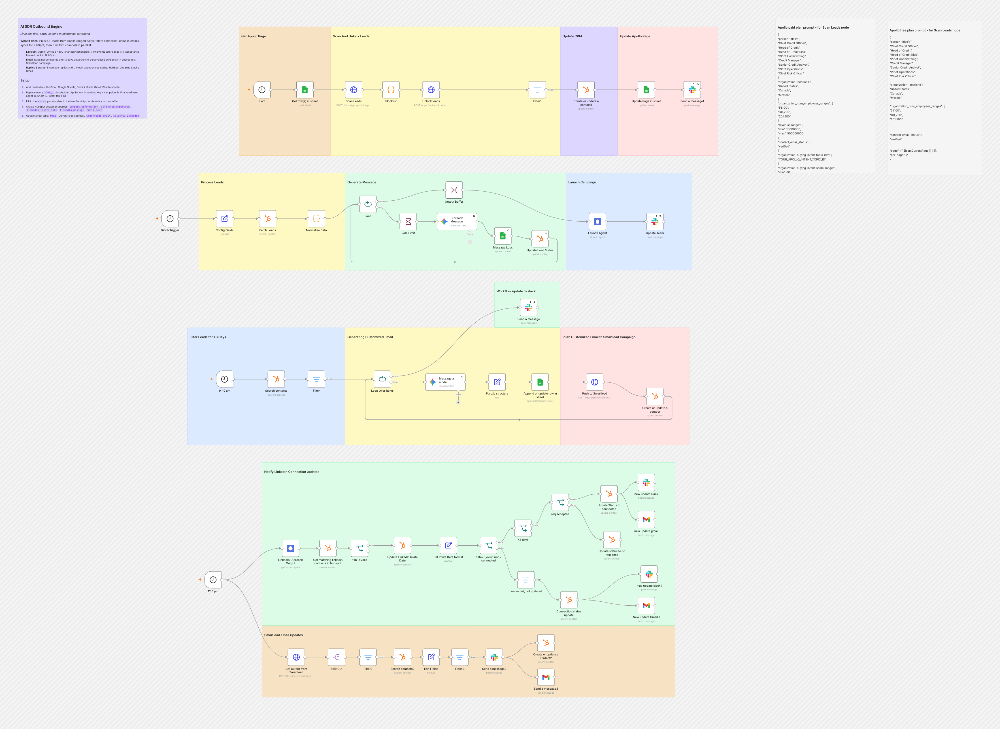
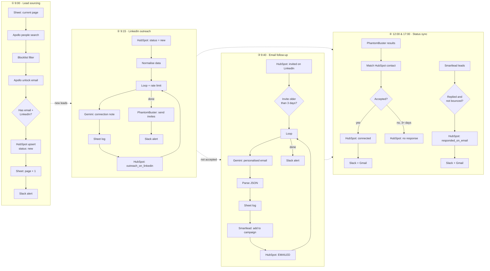

# AI SDR Outbound Engine

**LinkedIn-first, email-second multichannel outbound, on autopilot.**

A multichannel B2B outreach system built in n8n. Every morning it pulls fresh ICP leads from Apollo, enriches them into HubSpot, and sends each lead through a LinkedIn-first, email-second sequence. Gemini writes every message, and the workflow tracks replies and connection acceptances back into the CRM automatically.

Built for, and run in production with, a B2B SaaS sales team. Client details have been removed from this version.




---

## What it does

| Time | Branch | What happens |
|---|---|---|
| **9:00** | Lead sourcing | Searches Apollo for ICP prospects (titles, geography, headcount, revenue, buying intent), drops blocklisted companies, unlocks verified emails and upserts each lead into HubSpot with status `new`. The workflow saves its place in Apollo's results, so each run pulls a fresh page. |
| **9:15** | LinkedIn outreach | Picks up `new` leads. Gemini picks one of three message angles from the lead's company context and writes a connection note under 300 characters. The note is logged to Sheets and the lead is marked `outreach_on_linkedin`. PhantomBuster then sends the connection requests. |
| **9:40** | Email follow-up | Finds leads whose LinkedIn invite has gone unaccepted for **more than 3 days**. Gemini cleans the name and company, extracts the company's key focus and writes a personalised cold email from one of three templates. The email is pushed into a Smartlead campaign as custom fields and the lead is marked `EMAILED`. |
| **12:00 & 17:00** | Status sync | Reads PhantomBuster's results and updates each lead in HubSpot as `connected_on_linkedin` or `no_response_on_linkedin`. It also pulls Smartlead leads that have replied and haven't bounced, marks them `responded_on_email`, and alerts the team on Slack and Gmail. |

### Lead lifecycle in HubSpot

```
new ──► outreach_on_linkedin ──┬──► connected_on_linkedin            (invite accepted)
                               │
                               └──► 3+ days, not accepted
                                      ├──► no_response_on_linkedin   (status sync)
                                      └──► EMAILED ──► responded_on_email
```

## Flow diagram



## Tools

| Tool | Role |
|---|---|
| **n8n** | Orchestration: 4 scheduled branches, loops, rate limiting, branching logic |
| **Apollo.io API** | Prospect search with ICP and buying-intent filters, plus email unlock |
| **HubSpot** | The CRM and the record of where each lead is in the sequence (custom lead statuses and properties) |
| **Google Gemini 2.5 Flash** | Data cleaning, industry normalisation, and choosing a template and writing copy for both channels |
| **PhantomBuster** | Sends LinkedIn connection requests and reports whether they were accepted |
| **Smartlead** | Cold email sending, with the AI-written subject and body passed in as custom fields |
| **Google Sheets** | Pagination state and message logs |
| **Slack + Gmail** | Team notifications for new leads, sends, connections and replies |

## Design notes

- **LinkedIn first, then email.** Leads get a low-pressure connection request first. The email goes out only if the request isn't accepted within 3 days, and it mentions the request ("I sent you a LinkedIn request a few days ago…") so it reads as a natural follow-up.
- **The AI chooses the angle as well as the words.** Both prompts contain three template options with trigger rules. Gemini classifies the lead's company context and picks the best fit, so messages stay on-brand while still being personalised.
- **Data cleaning happens inside the prompt.** Gemini converts names to title case ("HOLLY" → "Holly"), shortens legal company names to how people actually say them, and turns long industry labels into short phrases before writing.
- **Structured output.** The email prompt returns strict JSON (`subject`, `body`), which is parsed before it goes to Smartlead.
- **Each run pulls new leads.** A page counter in Sheets moves through Apollo's results, so each daily run gets new prospects rather than the same ones again.
- **Respects rate limits.** It loops in batches with wait nodes between Gemini calls and before handing off to PhantomBuster.

## Setup

1. **Import:** in n8n, go to **Workflows → Import from File** and select [`workflow.json`](./workflow.json).
2. **Credentials:** connect HubSpot (OAuth2), Google Sheets, Google Gemini, Slack, Gmail and PhantomBuster.
3. **Replace the `YOUR_…` placeholders:**
   | Placeholder | Where |
   |---|---|
   | `YOUR_APOLLO_API_KEY` | `Scan Leads`, `Unlock leads` (header `X-Api-Key`) |
   | `YOUR_APOLLO_INTENT_TOPIC_ID` | `Scan Leads` request body (or delete the intent filter if you're on Apollo's free plan; both versions are in sticky notes) |
   | `YOUR_SMARTLEAD_API_KEY`, `YOUR_SMARTLEAD_CAMPAIGN_ID` | `Push to Smartlead`, `Get output from Smartlead` |
   | `YOUR_PHANTOMBUSTER_LAUNCH_AGENT_ID` / `…_OUTPUT_AGENT_ID` | `Launch Agent`, `LinkedIn Outreach Output` |
   | `YOUR_GOOGLE_SHEET_ID` | All Google Sheets nodes |
   | `#outreach-alerts`, `you@example.com` | Slack and Gmail nodes |

   > Tip: move API keys into n8n **Header Auth / Query Auth credentials** instead of pasting them into the request URL or headers.
4. **Personalise the prompts:** fill in the `<<…>>` placeholders in `Message a model` (email) and `Outreach Message` (LinkedIn) with your sender name, offer, proof points and segments.
5. **HubSpot:** create these custom contact properties: `company_information`, `estimated_employees`, `linkedin_invite_date`, `linkedin_message` and `email_sent`. Then add these lead status values: `outreach_on_linkedin`, `connected_on_linkedin`, `no_response_on_linkedin`, `emailed` and `responded_on_email`.
6. **Google Sheet** with these tabs: `Page` (a `CurrentPage` column, starting at 1), `Smartleads email`, and `Salesnav Linkedin`.
7. **Blocklist:** edit the `blocklist` Code node to exclude your existing customers, open deals and competitors.
8. Run each branch once manually to check it works, then activate the workflow.

---

Built by [Pranav Singla](https://pranavtheaiguy.vercel.app). See the [full portfolio](../../README.md).
