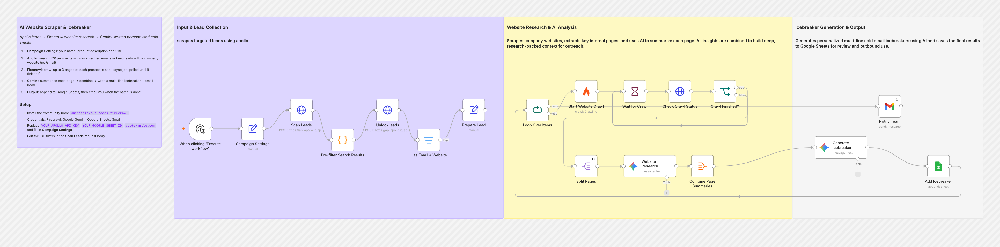
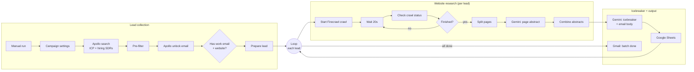

# AI Website Scraper & Icebreaker

**Cold emails that open with real research. The workflow reads each prospect's website so your reps don't have to.**

This workflow pulls ICP prospects from Apollo, crawls each company's website with Firecrawl, and has Gemini summarise every page. It then writes a multi-line icebreaker and email body based on details only someone who had actually read the site would know. The results go into a Google Sheet for review, and you get an email when the batch is done.

---

## What it does

| Step | What happens |
|---|---|
| **1. Campaign settings** | You set your name, product description and product URL once. These feed the copywriting prompt. |
| **2. Find prospects** | Searches Apollo for sales and growth leaders at 50–500-person companies in North America **that are currently hiring SDRs/BDRs**, a strong sign they're investing in outbound. |
| **3. Unlock and qualify** | Unlocks verified emails and keeps only leads with a company website and a work email address (no Gmail). |
| **4. Crawl the website** | Starts a Firecrawl crawl of up to 3 pages per company, then **checks the job until it finishes** (crawls run asynchronously). |
| **5. Research each page** | Gemini writes a short, plain-language abstract of each crawled page. The abstracts are then combined into one research brief. |
| **6. Write the email** | Gemini turns the brief and the prospect's profile into a multi-line icebreaker and email body, connecting non-obvious details from the website to your product's most relevant benefit. |
| **7. Output** | Appends each lead and their email to Google Sheets, then emails you once the whole batch is done. |

## Flow diagram

## Tools

| Tool | Role |
|---|---|
| **n8n** | Orchestration: lead loop, polling the crawl job, splitting and combining pages |
| **Apollo.io API** | Prospect search with ICP and hiring filters, plus email unlock |
| **Firecrawl** | Crawls each prospect's website and returns clean Markdown for each page |
| **Google Gemini 2.5 Flash** | Summarises each page and writes the personalised email |
| **Google Sheets** | Output for review before sending |
| **Gmail** | Notifies you when the batch is done |

## Design notes

- **Research happens per page, then gets combined.** Summarising each page separately keeps every prompt small and focused, and the combined brief covers more of the site than a single homepage scrape would.
- **Handles async crawls properly.** Firecrawl crawls run as background jobs. The workflow waits, checks the status and repeats until the job finishes (or fails), so it never passes an empty page to the AI.
- **Uses hiring as a buying signal.** The Apollo search targets companies that are hiring SDRs or BDRs, which means they're actively spending on outbound and are a good fit for sales-related offers.
- **Saves Apollo credits.** People Apollo already marks as having no email are dropped before the paid unlock call.
- **Guards against generic AI copy.** The prompt bans generic praise and asks for small, specific details that prove the research was real.
- **Output is reviewed by a person.** Emails go to a sheet rather than being sent automatically, so a person can review them before a sequencer sends anything.

## Setup

1. **Install the community node** `@mendable/n8n-nodes-firecrawl` (go to **Settings → Community Nodes**).
2. **Import:** go to **Workflows → Import from File** and select [`workflow.json`](./workflow.json).
3. **Credentials:** Firecrawl, Google Gemini, Google Sheets and Gmail. `Check Crawl Status` reuses the Firecrawl credential.
4. **Replace placeholders:**
   | Placeholder | Where |
   |---|---|
   | `YOUR_APOLLO_API_KEY` | `Scan Leads`, `Unlock leads` (header `X-Api-Key`) |
   | `YOUR_GOOGLE_SHEET_ID` | `Add Icebreaker` |
   | `you@example.com` | `Notify Team` |
   | `<<YOUR_NAME>>`, `<<ONE_PARAGRAPH_PRODUCT_…>>`, Product URL | `Campaign Settings` |

   > Tip: move the Apollo key into an n8n **Header Auth** credential instead of pasting it into the node.
5. **Google Sheet:** create a tab named `Leads` with these columns:
   `first_name, last_name, designation, email, website_url, location, Outreach Content`
6. **Adjust the ICP** in the `Scan Leads` request body (titles, hiring signals, locations, headcount, revenue, `per_page`).
7. Click **Execute workflow**.

---

Built by [Pranav Singla](https://pranavtheaiguy.vercel.app). See the [full portfolio](../../README.md).
