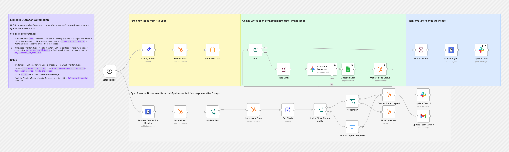
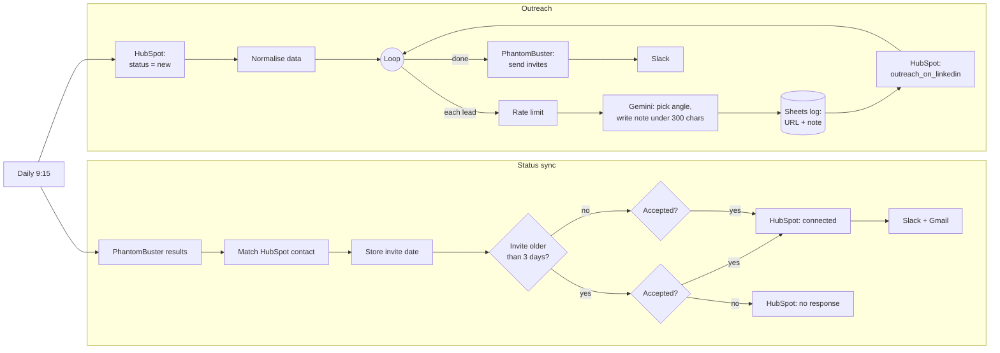

# LinkedIn Outreach Automation

**Personalised LinkedIn connection requests sent every day, with each lead's status kept up to date in HubSpot automatically.**

Every morning this workflow pulls new leads from HubSpot, has Gemini write a short, personalised connection note for each one, and hands them to PhantomBuster to send. It also reads back who accepted and updates each lead in HubSpot as connected or not responding. The team gets a Slack and email ping whenever someone accepts.

> This is the standalone LinkedIn channel. For the full LinkedIn-first, email-second sequence with Apollo sourcing and Smartlead follow-ups, see the [AI SDR Outbound Engine](../ai-sdr-outbound-engine).




---

## What it does

At **9:15 every day**, one trigger starts two branches:

| Branch | What happens |
|---|---|
| **Outreach** | Fetches HubSpot contacts with lead status `new`. For each one, in a rate-limited loop, Gemini normalises the industry ("International Banking & Capital Markets" → "Capital Markets"), picks one of **three message angles** from the company context, and writes a connection note **under 300 characters**. The LinkedIn URL and note are logged to Google Sheets and the lead is marked `outreach_on_linkedin`. Once the loop finishes, PhantomBuster sends the invites from that sheet and Slack is notified. |
| **Status sync** | Reads PhantomBuster's results, matches each profile to its HubSpot contact and stores the invite date. **Accepted** marks the lead `connected_on_linkedin` and pings Slack and Gmail. **More than 3 days with no acceptance** marks it `no_response_on_linkedin`. |

### Lead lifecycle in HubSpot

```
new ──► outreach_on_linkedin ──┬──► connected_on_linkedin     (accepted → Slack + Gmail)
                               └──► no_response_on_linkedin   (3+ days, not accepted)
```

## Flow diagram



## Tools

| Tool | Role |
|---|---|
| **n8n** | Scheduling, the rate-limited loop, branching logic and the sync |
| **HubSpot** | The source of leads and the record of where each lead is in the sequence (lead statuses plus `linkedin_invite_date` and `linkedin_message`) |
| **Google Gemini 2.5 Flash** | Normalising industries, choosing a message angle and writing the note |
| **Google Sheets** | The queue PhantomBuster reads from (URL and message), plus a log |
| **PhantomBuster** | Sends LinkedIn connection requests and reports whether they were accepted |
| **Slack + Gmail** | Team alerts when someone accepts |

## Design notes

- **The AI chooses the angle as well as the words.** The prompt defines three templates with keyword triggers (speed, accuracy, founder story). Gemini classifies each lead and picks the best fit, so notes stay on-brand while still being personal.
- **Notes stay within LinkedIn's limit.** There's a hard rule in the prompt to stay under 300 characters (LinkedIn's limit for connection notes), and stray quote marks are stripped before logging.
- **A sheet sits between Gemini and PhantomBuster.** Gemini writes to a sheet and PhantomBuster reads from it. This keeps PhantomBuster's native spreadsheet input and leaves a record of every message.
- **Rate-limited loop.** Wait nodes space out the Gemini calls, and PhantomBuster is only launched once all the notes are written.
- **Status is always the same for the same result.** Acceptance is checked before the 3-day timeout, so a late accept is never marked as no response.

## Setup

1. **Import:** go to **Workflows → Import from File** and select [`workflow.json`](./workflow.json).
2. **Credentials:** HubSpot (OAuth2), Google Gemini, Google Sheets, Slack, Gmail and PhantomBuster.
3. **Replace placeholders:**
   | Placeholder | Where |
   |---|---|
   | `YOUR_GOOGLE_SHEET_ID` | `Message Logs` |
   | `YOUR_PHANTOMBUSTER_LAUNCH_AGENT_ID` | `Launch Agent` |
   | `YOUR_PHANTOMBUSTER_OUTPUT_AGENT_ID` | `Retrieve Connection Results` |
   | `#outreach-alerts`, `you@example.com` | Slack and Gmail nodes |
   | `<<…>>` placeholders | `Outreach Message` prompt: your name, company, sector and one-line background |
4. **HubSpot:** create these custom contact properties: `company_information`, `linkedin_invite_date` and `linkedin_message`. Then add these lead status values: `outreach_on_linkedin`, `connected_on_linkedin` and `no_response_on_linkedin`.
5. **Google Sheet:** create a tab named `Salesnav Linkedin` with the columns `LinkedinUrl` and `LinkedIn_message`.
6. **PhantomBuster:** set up a *LinkedIn Outreach* phantom whose input is that sheet tab (profile URL column `LinkedinUrl`, message column `LinkedIn_message`).
7. Run once manually, then activate the workflow.

---

Built by [Pranav Singla](https://pranavtheaiguy.vercel.app). See the [full portfolio](../../README.md).
