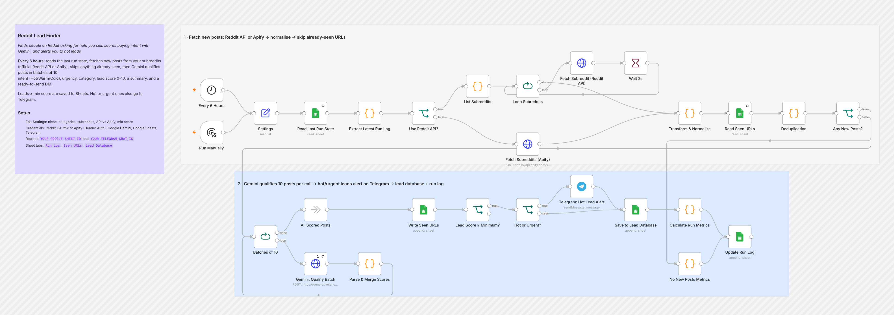
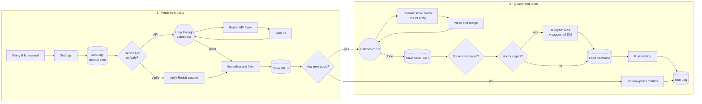

# Reddit Lead Finder

**Finds people on Reddit who are asking for exactly what you sell, scores their buying intent with AI, and alerts you to hot leads with a ready-to-send DM.**

Every 6 hours this workflow checks your chosen subreddits for new posts and skips anything it has already seen. Gemini then qualifies the new posts in batches: intent, urgency, category, a 0–10 lead score, a short summary and a personalised first-contact message. Qualified leads go into a Google Sheets database, and hot or urgent ones go straight to Telegram.

---

## What it does

| Step | What happens |
|---|---|
| **1. Settings** | Everything is configured in one place: your niche, lead categories, subreddits, the data source and the minimum lead score. |
| **2. Remember the last run** | Reads the last run's timestamp from a `Run Log` tab, so only posts created since then are processed. |
| **3. Fetch** | Uses either the **official Reddit API** (OAuth2, looping through subreddits with a 2-second pause between requests) or an **Apify Reddit scraper** (one call, residential proxy). |
| **4. Normalise and skip seen posts** | Converts both sources into the same format, drops deleted or removed posts and low-score posts, and skips any URL already in the `Seen URLs` tab. |
| **5. Qualify with Gemini** | Sends **10 posts per call** and gets back a JSON array with each post's `intent_level` (Hot, Warm or Cold), `urgency`, `category`, `genuine_inquiry`, `likely_customer`, `lead_score`, `post_summary`, `outreach_message` and `ai_reasoning`. |
| **6. Route** | Leads at or above the minimum score are saved to the `Lead Database`. **Hot or high-urgency** leads also trigger a Telegram alert that includes the suggested DM. |
| **7. Log the run** | Records the run's metrics (posts fetched, qualified, hot) in `Run Log`, including runs that found nothing new. |

## Flow diagram

## Tools

| Tool | Role |
|---|---|
| **n8n** | Scheduling, choosing the data source, batching, routing and keeping track of what's already been processed |
| **Reddit API** *or* **Apify** | Source of new posts. Use the official API for free, rate-limited access or Apify for higher volume. |
| **Google Gemini 2.5 Flash** | Scores each batch and returns structured JSON (`responseMimeType: application/json`) |
| **Google Sheets** | Three tabs: `Run Log` (state and metrics), `Seen URLs` (dedup) and `Lead Database` (output) |
| **Telegram** | Instant alerts for hot or urgent leads |

## Design notes

- **Never processes a post twice.** A timestamp of the last run plus a list of seen URLs means every run only scores genuinely new posts, which keeps AI costs flat as the sheet grows.
- **Fewer AI calls through batching.** 10 posts go to Gemini in a single call (set to run once per batch), and the response is mapped back to each post by position.
- **Choice of data source.** Switch between the free Reddit API and an Apify scraper with one setting. Both feed the same normaliser.
- **Handles failures safely.** JSON parsing removes stray code fences. If parsing still fails, the batch is marked `Pending AI Review` instead of being lost. Gemini calls are retried on failure.
- **Logs runs with no new posts too.** You can see the workflow is healthy even on quiet days.
- **Easy to point at any niche.** Change `niche`, `categories` and `subreddits` in Settings. The prompt and the sheet adapt automatically.

## Setup

1. **Import:** go to **Workflows → Import from File** and select [`workflow.json`](./workflow.json).
2. **Edit `Settings`:**
   | Field | Example |
   |---|---|
   | `niche` | *"a Canadian immigration consultancy (visas, study and work permits, PR, sponsorship)"* |
   | `categories` | `Visitor\|Student\|Work\|PR\|Spousal\|Super Visa\|Other` |
   | `subreddits` | `["ImmigrationCanada", "prCanada", …]` |
   | `use_reddit_api` | `true` = Reddit API, `false` = Apify |
   | `min_lead_score` | `6` |
3. **Credentials:**
   - Reddit OAuth2 (if using the API) **or** Apify: a *Header Auth* credential with `Authorization: Bearer <your Apify token>`
   - Google Gemini, Google Sheets and Telegram
4. **Replace placeholders:** `YOUR_GOOGLE_SHEET_ID` (in all Sheets nodes) and `YOUR_TELEGRAM_CHAT_ID`.
5. **Google Sheet** with three tabs:
   - `Run Log`: `timestamp, total_posts_fetched, leads_qualified, hot_leads, last_post_ids, execution_status`
   - `Seen URLs`: `post_url`
   - `Lead Database`: `Date, Platform, Source, Username, Subreddit, Post URL, Post Title, Post Summary, Category, Intent Level, Urgency, Genuine Inquiry, Likely Customer, Lead Score, AI Reasoning, Outreach Message, Status, Notification Sent, Created At, Last Updated`
6. Click **Run Manually** once, check the sheet, then activate the workflow.

> **Be a good Reddit citizen:** follow each subreddit's rules on self-promotion, and use the suggested DM as a helpful first reply rather than spam.

---

Built by [Pranav Singla](https://pranavtheaiguy.vercel.app). See the [full portfolio](../../README.md).
