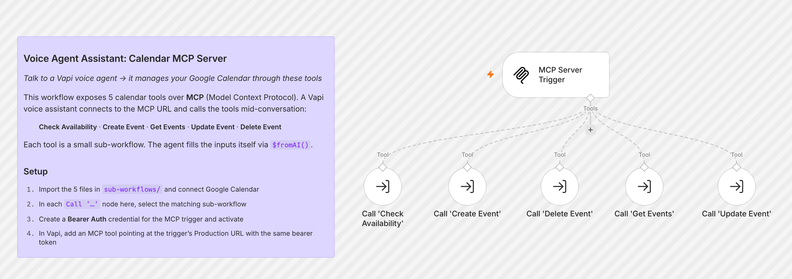
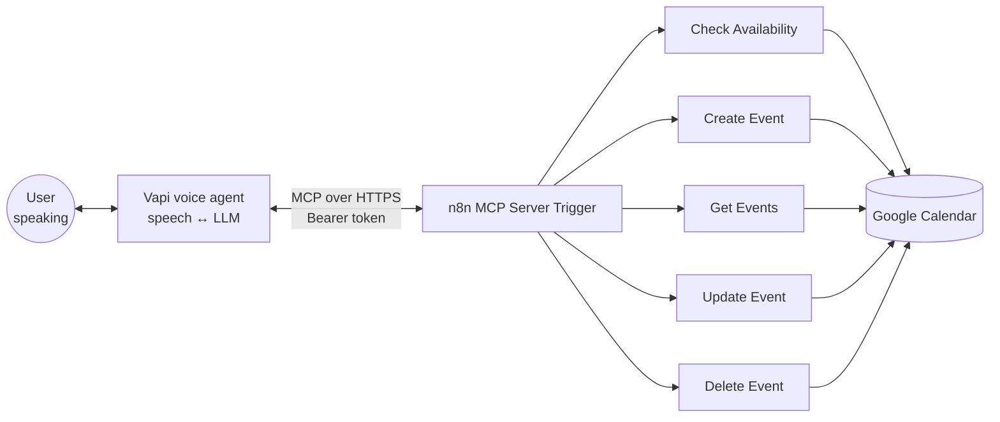

# Voice Agent Assistant

**Manage your calendar by talking to it. A Vapi voice agent books, moves and cancels Google Calendar events through an n8n MCP server.**

You talk to a voice assistant the way you'd talk to a human assistant: *"Am I free Thursday afternoon?"*, *"Book a call with Sarah at 3"*, *"Push my 4 pm to tomorrow"*. The agent works out what you want and calls the right calendar tool mid-conversation. n8n exposes those tools over the **Model Context Protocol (MCP)**, so you never have to open the calendar app yourself.

---

## What it does

The main workflow is an **MCP Server Trigger** that exposes five tools. Each tool is a small sub-workflow, and the voice agent fills in each tool's inputs itself (via n8n's `$fromAI()`).

| Tool | Inputs (filled by the agent) | Returns |
|---|---|---|
| **Check Availability** | `afterTime`, `beforeTime` | "The slot is available" or "The slot is already taken. Please suggest another time" |
| **Create Event** | `summary`, `start`, `end` | `status`, `eventID`, calendar link |
| **Get Events** | `aftertime`, `beforetime` | A list of `eventID`, `summary`, `start` and `end` for each event |
| **Update Event** | `eventID`, `starttime`, `endtime` | The updated event |
| **Delete Event** | `eventID` | Confirmation |

The tool descriptions tell the agent to **check availability before booking**, to **look up event IDs with Get Events** before rescheduling or deleting, and to **confirm with the user before deleting**.

## Flow diagram

**Example conversation**

> **You:** "Can you move my call with Sarah to Friday at 11?"
> **Agent:** calls *Get Events* (finds the event's ID) → *Check Availability* (Friday 11:00–11:30) → *Update Event*
> **Agent:** "Done. Your call with Sarah is now Friday at 11."

## Tools

| Tool | Role |
|---|---|
| **n8n** | MCP server and the five tool sub-workflows |
| **Model Context Protocol (MCP)** | Standard interface that lets the voice agent discover and call the tools |
| **Vapi** | Voice layer: speech-to-text, the LLM (OpenAI), text-to-speech, and calling tools |
| **Google Calendar API** | Checking availability and creating, reading, updating and deleting events |

## Design notes

- **MCP instead of separate webhooks.** The agent discovers all five tools from one URL, along with their descriptions and input schemas. Adding a sixth tool only means adding a node in n8n, with no changes to Vapi.
- **One sub-workflow per tool.** Each tool can be tested on its own and reused by other agents, such as a chat assistant or a Slack bot, without touching the server.
- **The agent fills the inputs.** `$fromAI()` gives every input a description (for example, "ISO 8601 with timezone offset"), so the LLM sends correctly formatted times and IDs.
- **Small outputs for voice.** Get Events returns only the four fields the agent needs, which keeps responses short and fast enough for a live conversation.
- **Authenticated endpoint.** The MCP trigger requires a Bearer token, so only your Vapi assistant can change your calendar.

## Setup

1. **Import the sub-workflows first:** go to **Workflows → Import from File** and import each file in [`sub-workflows/`](./sub-workflows):
   `check-availability.json`, `create-event.json`, `get-events.json`, `update-event.json`, `delete-event.json`
2. **Connect Google Calendar** in each sub-workflow. They use your `primary` calendar by default.
3. **Import the MCP server:** import [`workflow.json`](./workflow.json). In each `Call '…'` node, **select the matching sub-workflow** from the list. Workflow IDs are unique to each n8n instance, so this link has to be set by hand.
4. **Secure the endpoint:** create a **Bearer Auth** credential on the `MCP Server Trigger` with a long random token.
5. **Activate** the MCP server workflow and copy its **Production URL**.
6. **In Vapi:**
   - Create an assistant, choose your model (e.g. OpenAI) and a voice
   - Add an **MCP tool** with the Production URL and the header `Authorization: Bearer <your token>`
   - In the system prompt, give the agent your timezone and tell it to check availability before booking and to confirm before deleting
7. Call your assistant and ask it what's on your calendar today.

---

Built by [Pranav Singla](https://pranavtheaiguy.vercel.app). See the [full portfolio](../../README.md).
