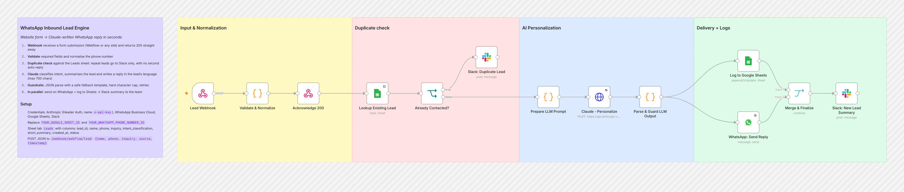
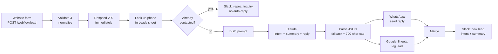

# WhatsApp Inbound Lead Engine

**A website form lead gets a personalised WhatsApp reply written by Claude within seconds, not hours.**

When someone fills in a contact form, this workflow validates the lead, checks whether they've already been contacted, and has Claude read their inquiry. Claude classifies the intent, summarises the lead and writes a reply in the lead's own language. The reply goes out on WhatsApp, the lead is logged to Google Sheets, and the team gets a Slack summary. Nobody has to touch it.




---

## What it does

| Step | What happens |
|---|---|
| **1. Capture** | A webhook receives the form submission (from Webflow or any site that can POST JSON) and **returns `200` straight away**, so the form never waits on the AI. |
| **2. Validate** | Rejects the submission if a required field (`name`, `phone`, `inquiry`, `source`, `timestamp`) is missing, normalises the phone number and gives the lead a unique `lead_id`. |
| **3. Check for duplicates** | Looks the phone number up in the Leads sheet. If this person has already been contacted, the team is alerted on Slack and **no second auto-reply is sent**. |
| **4. Claude** | Classifies intent (pricing, demo, support, general), writes a one-line summary, and writes a WhatsApp reply of up to 700 characters in the lead's language. |
| **5. Guardrails** | Parses Claude's output as strict JSON. If parsing fails, it falls back to a safe template reply, enforces a hard 700-character cap, and retries the Claude and WhatsApp calls on failure. |
| **6. Deliver** | Sends the WhatsApp reply and logs the lead to Google Sheets at the same time, then posts the intent and summary to Slack. |

## Flow diagram



## Tools

| Tool | Role |
|---|---|
| **n8n** | Webhook intake, validation, branching, running steps in parallel, merging results |
| **Claude (Anthropic API)** | Classifying intent, summarising the lead, writing the reply in the lead's language |
| **WhatsApp Business Cloud API** | Sending the reply to the lead |
| **Google Sheets** | Lead log and the source for the duplicate check |
| **Slack** | Team alerts for new leads and repeat inquiries |

## Design notes

- **The form responds before the AI runs.** The webhook replies `200` before Claude is called, so a slow model never breaks the website form.
- **No double-messaging.** Repeat submissions from the same phone number reach the team on Slack instead of triggering a second automated message.
- **The AI can fail without breaking anything.** If Claude returns something that isn't valid JSON, the lead still gets a polite holding message rather than nothing or a broken reply.
- **Minimal personal data goes to the model.** Claude receives the lead's name, inquiry and source, but not their phone number.
- **Replies in the lead's language.** The prompt tells Claude to answer in whatever language the lead wrote in.

## Setup

1. **Import:** in n8n, go to **Workflows → Import from File** and select [`workflow.json`](./workflow.json).
2. **Credentials:**
   - **Anthropic:** create a *Header Auth* credential with name `x-api-key` and your API key as the value
   - **WhatsApp Business Cloud**, **Google Sheets** and **Slack (OAuth2)**
3. **Replace placeholders:** `YOUR_WHATSAPP_PHONE_NUMBER_ID` (in `WhatsApp: Send Reply`), `YOUR_GOOGLE_SHEET_ID` (in both Sheets nodes) and the Slack channel `#inbound-leads`.
4. **Google Sheet:** create a tab named `Leads` with these columns:
   `lead_id, name, phone, inquiry, intent_classification, short_summary, created_at, status`
5. **Connect your form** so it POSTs JSON to `https://<your-n8n>/webhook/webflow/lead`:
   ```json
   {
     "name": "Jane Doe",
     "phone": "+15551234567",
     "inquiry": "Hi, can I get pricing for a team of 10?",
     "source": "website-contact-form",
     "timestamp": "2026-01-01T10:00:00Z"
   }
   ```
6. Activate the workflow and submit a test lead.

> **WhatsApp note:** Meta only allows free-form messages within 24 hours of the user messaging you. To message a lead who has only filled in a form, use an **approved message template** for the first reply, or add a click-to-WhatsApp button to the form so the lead starts the conversation themselves.

---

Built by [Pranav Singla](https://pranavtheaiguy.vercel.app). See the [full portfolio](../../README.md).
