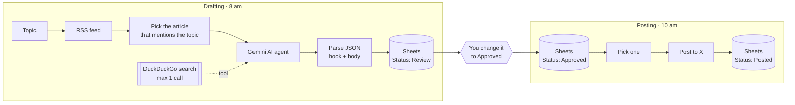

# X Content Engine

**Researched X posts drafted every morning. You approve them with one cell edit, and they go out automatically.**

Every day this workflow finds a fresh article about your topic, has a Gemini agent research the tool behind it, and drafts a post written from an engineer's point of view: hook, problem, solution, technical breakdown and a "comment to claim" CTA. Drafts wait in Google Sheets for your approval. Once a day, one approved post is published to X.

---

## What it does

| Time | Branch | What happens |
|---|---|---|
| **8:00** (or manual) | Drafting | Reads your RSS feed and picks the latest article that mentions your **Topic** (or falls back to the newest article). A Gemini **AI agent** runs **one** DuckDuckGo search to research the tool or topic, then writes a post following a strict template. The post is parsed from JSON and saved to Sheets with `Status = Review`. |
| *any time* | **You** | Read the drafts in the sheet and change the ones you like to `Status = Approved`. |
| **10:00** | Posting | Takes **one** `Approved` row, posts `HOOK + BODY` to X, and marks the row `Posted` with a timestamp. |

### Post template the agent follows

1. **Hook:** a scroll-stopping line about a specific technical pain
2. **Agitation:** why the manual way is painful
3. **Solution:** "I built an n8n workflow that…"
4. **Breakdown:** ✅ ⚡ 🛠️ bullets describing what the system actually does (webhooks, APIs, scraping…)
5. **CTA:** "Comment '[KEYWORD]'" and "Follow me" to claim the asset

## Flow diagram

## Tools

| Tool | Role |
|---|---|
| **n8n** | Two scheduled branches, an AI agent with a tool, parsing and state in Sheets |
| **Google Gemini 2.5 Flash-Lite** | The agent's model: research and writing |
| **DuckDuckGo search** (community node) | Gives the agent one web search to check facts |
| **RSS** (e.g. rss.app) | A fresh source of article ideas |
| **Google Sheets** | The draft queue and approval step, plus the posting log |
| **X API** | Publishing |

## Design notes

- **A person approves every post.** The AI drafts, you approve, the workflow publishes. Changing a single cell is the whole review step, and nothing is posted without it.
- **Search is capped at one call.** The agent may search **once**, then must rely on what it already knows. This keeps costs and run time predictable and stops the agent looping through searches.
- **Avoids generic sales framing.** The system prompt bans "get more leads" angles unless the tool really is a sales tool, and pushes concrete technical detail instead.
- **Parses AI output safely.** The parser extracts the JSON between the first `{` and the last `}` (removing Markdown code fences) and falls back safely, so one bad response never stops the run.
- **Posts at a steady pace.** A Limit node posts at most one approved draft per day, even if several are approved.

## Setup

1. **Install the community node** `n8n-nodes-duckduckgo-search` (go to **Settings → Community Nodes**).
2. **Import:** go to **Workflows → Import from File** and select [`workflow.json`](./workflow.json).
3. **Credentials:** Google Gemini, Google Sheets and X (OAuth2).
4. **Replace placeholders:** `YOUR_RSS_FEED_URL` (in `RSS Feed`) and `YOUR_GOOGLE_SHEET_ID` (in all three Sheets nodes). Set your topic in the `Topic` node.
5. **Google Sheet:** create a tab named `Posts` with these columns: `Topic, HOOK, BODY, Status, Created, Posted`
6. Run the drafting branch manually once, approve a row, then activate the workflow.

> **Post length:** these posts usually run over 280 characters. Long posts need **X Premium**. Otherwise, add a 280-character rule to the system prompt.

---

Built by [Pranav Singla](https://pranavtheaiguy.vercel.app). See the [full portfolio](../../README.md).
